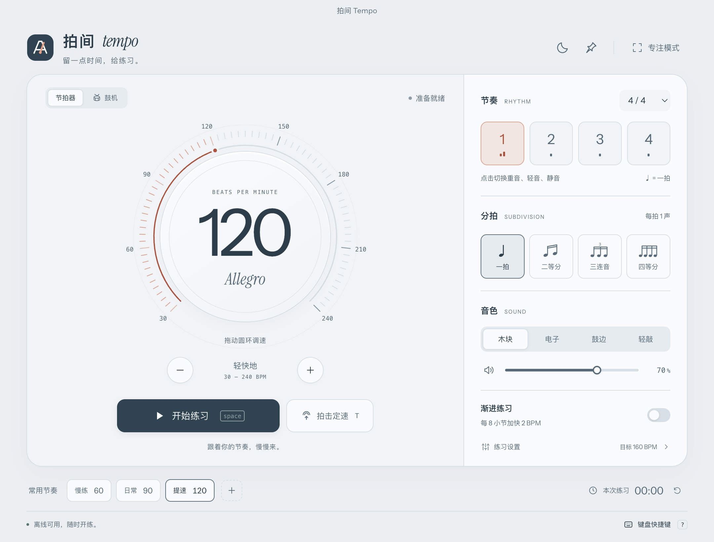
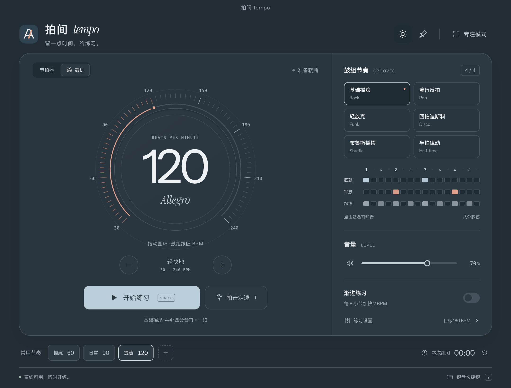

# Paijian Tempo · 拍间

**Make a little time for practice.**

An offline Mac metronome and simple drum machine. No account, ads, or streamed
audio. Open it and start practicing.

[简体中文](README.md) · [Contributing](CONTRIBUTING.md) · [MIT License](LICENSE)



## Features

- **30–240 BPM** with a draggable tempo dial, direct entry, fine adjustment, and
  tap tempo.
- **Metronome:** multiple meters, 1–4 sounds per beat, and an accent, normal, or
  silent setting for each beat.
- **Six drum grooves:** Rock, Pop, Funk, Disco, Shuffle, and Half-time.
- **Practice tools:** increase BPM every few bars, set a target tempo, and stop
  after a chosen amount of playback time.
- **Presets:** save your setup, or hover over any preset and click × to remove it.
- **Light, dark, and focus views,** keyboard controls, window pinning, and
  continued playback while the window is in the background or minimized.
- **Offline assets:** bundled fonts, locally synthesized sounds, and preferences
  stored on your machine.

## Drum machine

Select **鼓机** at the top left, choose a groove, and use the same tempo dial.

| Groove    | Feel                                                    |
| --------- | ------------------------------------------------------- |
| Rock      | Eighth-note hats, kick on 1 and 3, snare on 2 and 4     |
| Pop       | Syncopated kick and an open hat near the end of the bar |
| Funk      | Sixteenth-note hats, syncopated kick, and a ghost snare |
| Disco     | Four-on-the-floor kick and offbeat open hats            |
| Shuffle   | Triplet grid with a 2:1 long–short hat pattern          |
| Half-time | Snare on beat 3 for a more spacious feel                |

Every groove is a one-bar 4/4 loop. BPM always counts quarter notes, including
Shuffle. Groove changes enter on the next bar. Click the kick, snare, or hat
label to mute that part independently.



The interface is currently in Simplified Chinese, with English groove names
and utility labels.

## Run from source

Requires **Node.js 22.12 or later**. The verified desktop platform is **macOS on
Apple Silicon**.

```sh
npm ci
npm start
```

Build the Mac app:

```sh
npm run pack
```

On Apple Silicon, the app is written to `dist/mac-arm64/拍间 Tempo.app`. This is
a local build without Apple notarization. Compiled application bundles are not
included in the repository.

For a browser preview, run `npm run preview` and open the local URL printed in
the terminal. Window pinning and the application shortcut menu require the
desktop app.

## Keyboard controls

| Key           | Action                            |
| ------------- | --------------------------------- |
| Space         | Start / pause                     |
| ↑ / ↓         | Change tempo by 1 BPM             |
| Shift + ↑ / ↓ | Change tempo by 10 BPM            |
| T             | Tap tempo                         |
| F             | Toggle focus view                 |
| M             | Mute / unmute                     |
| ?             | Show shortcuts                    |
| Esc           | Close a dialog / leave focus view |

Inputs and focused buttons retain their standard keyboard behavior. Tab to the
tempo dial to adjust it with the arrow keys.

## Audio and verification

The clock and synthesis run on the **AudioWorklet audio thread**. Fractional
sample intervals retain their remainder to avoid accumulating timing error.
Visuals follow the audio output clock. Pause clears active sound tails; meter,
subdivision, and groove changes take effect at bar boundaries.

```sh
npm test                 # 16 audio and clock checks
npm run test:desktop     # Real Electron windows and audio output on a Mac
npm run format:check
```

Desktop checks use temporary profiles and leave normal practice preferences
alone. See [CONTRIBUTING.md](CONTRIBUTING.md) for the project layout and optional
packaged-app checks.

## License

Application source, original icons, and documentation are available under the
[MIT License](LICENSE). Bundled Instrument Sans and Instrument Serif fonts keep
their SIL Open Font License 1.1 notices. See
[THIRD_PARTY_NOTICES.md](THIRD_PARTY_NOTICES.md).
